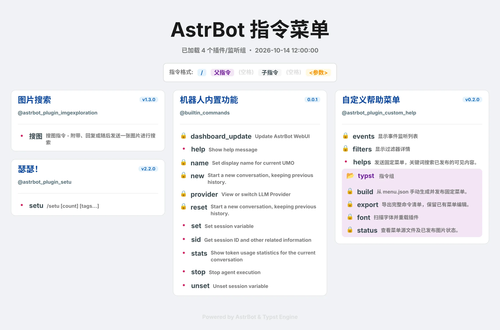
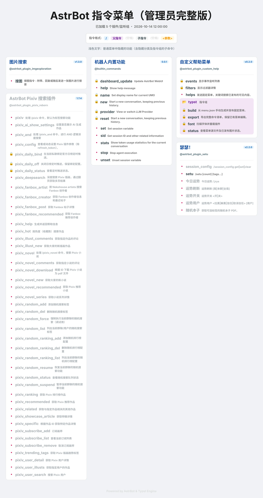

# AstrBot Custom Help | 自定义帮助菜单

<div align="center">

[](https://github.com/AstrBotDevs/AstrBot)
[](https://www.python.org/)
[](LICENSE)
[](https://github.com/allenx555/astrbot_plugin_custom_help/releases)
[](https://github.com/allenx555/astrbot_plugin_custom_help/actions/workflows/release.yml)

**编辑一次，手动发布，自定义帮助菜单。**

</div>

基于 Typst 的固定帮助菜单。管理员编辑 JSON、手动构建图片；用户查看帮助时只读取已发布文件，不查询实时命令注册表，也不重新渲染。

## 功能

- 完整导出命令、别名、指令组及子命令，包含隐藏、系统和管理员功能。
- 在 JSON 中编辑分类名称、命令说明、显示开关和排列顺序，也可补充自定义功能说明。
- 一次构建普通版和管理员完整版，管理员可以看到用浅灰色区分的隐藏内容。
- 按关键词搜索已发布菜单的分类、命令、描述及别名；管理员还可使用实时事件和过滤器诊断。
- 自定义字体、配色和三列卡片布局；可编辑 `templates/base.typ` 修改 Typst 模板。

## 功能预览

下图来自仓库中的真实 JSON 构建测试，展示当前普通版和管理员版；标题、版本及功能名称取自测试输入，不代表安装环境中的实时注册信息。

| 普通版 | 管理员完整版 |
| :---: | :---: |
|  |  |

## 使用

1. 管理员执行 `/typst export`，导出全部注册命令，包括隐藏、系统和管理员命令。
2. 编辑插件数据目录中的 `menu.json`，用分类和命令的 `visible` 控制展示。
3. 执行 `/typst build`，同时生成普通版和管理员完整版。
4. `/helps` 自动按 AstrBot 管理员身份发送对应版本；`/helps 关键词` 搜索已发布内容。

管理员执行 `/helps --public` 可预览普通用户看到的图片；`/helps --public 关键词` 只搜索普通用户可见的内容。该参数放在关键词前，仅影响本次请求，不修改身份、配置或已发布菜单。

`/` 以 AstrBot 实际配置的唤醒前缀为准。导出命令会返回文件路径，通常为 `data/plugin_data/astrbot_plugin_custom_help/menu.json`。

管理员完整版以浅灰色显示隐藏命令，隐藏分类及指令组的子命令也会标灰。普通用户只查看和搜索公开内容；`available: false` 的停用或失效项两版都不显示。`/help` 保留 AstrBot 内置功能。

重复导出保留已有编辑和顺序，新发现的功能默认隐藏。两版全部生成成功后一起发布，生成失败保留旧图。编辑 JSON、更改配置、重载插件均不会自动更新菜单；需再次执行 `/typst build`。

详见 [手动菜单说明](MANUAL_MENU.md) 与 [JSON 示例](menu.example.json)。

## 排列与设置

命令菜单按 JSON 顺序轮流向左、中、右三列追加完整卡片，跳过放不下的长列；三列都达到阈值时继续放入最短列。各列独立向下排列，卡片不会按布局拆分。

`rendering.column_height_pt` 控制长列跳过阈值，默认 `600pt`。字体、主题配色、PPI 及渲染超时在插件配置中设置。`rendering.max_concurrent_tasks` 限制本插件所有构建及诊断任务的同时编译数量。

字体默认从内置目录及 `data/plugin_data/astrbot_plugin_custom_help/fonts` 扫描，也可设置 `custom_font_path`。使用插件管理页面重载或 `/typst font` 更新可用字体。字体暂时不可用时保留用户配置，不自动删除选择。

### 添加字体

1. 将字体文件放入上述数据目录，或在 `custom_font_path` 中填写自定义字体目录的绝对路径。推荐使用 `.ttf` 或 `.otf`，其他格式是否可用取决于 Typst 的字体扫描支持。
2. 在 AstrBot 插件管理页面重载本插件，或执行 `/typst font`。
3. 在插件配置面板中选择字体并调整 `font_order`，然后执行 `/typst build`。

渲染按配置中的字体顺序选择可用字体，并追加 `Sarasa Gothic SC` 和 `Custom Help Emoji` 作为回退。字体文件名称与配置中的字体家族名称可能不同，以扫描结果为准。内置目录提供完整中文字体和精简图标字体；系统字体也可能参与扫描，但 Docker 中的宿主机字体不会自动出现在容器里。

为满足插件市场 16 MiB 安装包限制，内置 Emoji 字体仅保留模板图标和部分常用符号，不覆盖所有自定义 Emoji。需要完整 Emoji 支持时，可从 [Noto Emoji](https://github.com/googlefonts/noto-emoji) 获取完整字体，放入自定义字体目录，重载后在 `font_order` 中选择 `Noto Color Emoji` 并放在 `Custom Help Emoji` 前面，然后重新 build。字体子集可用 `.github/scripts/subset_emoji_font.py` 从完整字体重建；字体许可见 `resources/fonts/OFL-NotoEmoji.txt`。

Docker/NAS 用户应确保数据目录和自定义字体目录已挂载到容器，并填写容器内可访问的路径。

## 管理与诊断

| 命令 | 功能 | 权限 |
| --- | --- | --- |
| `/typst export` | 完整导出，保留编辑并备份旧源文件 | 管理员 |
| `/typst build` | 手动构建并发布两版固定菜单 | 管理员 |
| `/typst status` | 查看源文件和当前发布状态 | 管理员 |
| `/typst font` | 扫描字体并重载本插件 | 管理员 |
| `/helps [关键词]` | 固定图片或已发布菜单文本搜索 | 所有用户 |
| `/helps --public [关键词]` | 查看或搜索普通版，供管理员预览 | 所有用户 |
| `/events [关键词]` | 实时事件监听及工具诊断 | 管理员 |
| `/filters [关键词]` | 实时过滤器诊断 | 管理员 |

事件与过滤器视图保留原版实时诊断渲染；它们使用独立临时目录，不影响固定菜单。编译在独立进程中执行，超时或取消会终止该进程，插件卸载会收尾任务。

每次构建保留独立发布目录。失败构建会清理未发布文件；成功构建后清理超过七天的旧目录，同时保留当前菜单及最近三代目录。不会清理 `menu.json`、备份或自定义字体。

## 安装与更新

从 [Releases](https://github.com/allenx555/astrbot_plugin_custom_help/releases) 下载 `astrbot_plugin_custom_help-v版本号.zip`，通过 AstrBot 插件管理页面安装或更新并重载本插件。已有源文件及旧菜单兼容；升级后执行 `/typst build` 生成新版图片。

依赖：AstrBot（发布测试使用 `4.14.6`）、Python 3.10+、`typst>=0.14.7`、Pydantic 2、Pillow。不同 AstrBot 版本的注册表接口仍需实际验证。

## 常见问题

### 修改 JSON 或字体后，图片为什么没有变化？

菜单只在 `/typst build` 时更新。保存文件后重新构建；如修改了插件配置或添加了字体，先重载本插件，再构建。

### 隐藏命令会禁止用户调用吗？

不会。`visible` 只控制帮助菜单与菜单搜索；实际命令是否可用由插件和 AstrBot 的权限设置决定。隐藏父分类或指令组时，其子项在普通版中也隐藏。管理员版可查看这些隐藏项，但 `available: false` 的失效项两版都不展示。

### 为什么导出后仍有功能缺失？

导出只能读取已注册的信息。已卸载、加载失败的插件，以及在单个 Handler 内自行解析的子命令，可能无法完整识别。可在 JSON 中用唯一的 `custom:` 前缀 ID 手工补充，详见 [手动菜单说明](MANUAL_MENU.md)。

### 第一次使用没有图片，或构建失败怎么办？

首次使用需依次 export、编辑、build。构建失败时先看命令返回的错误和插件日志，检查 JSON、字体路径及依赖；已发布的旧菜单仍可使用。`/typst status` 可查看源文件路径和发布状态。

## 目录结构与开发测试

```text
astrbot_plugin_custom_help/
├── main.py                  # 插件入口、命令与菜单发布
├── metadata.yaml            # 插件身份及版本
├── _conf_schema.json        # 插件配置面板
├── core/
│   ├── analyzer.py          # 注册表导出与诊断数据
│   ├── menu.py              # JSON 合并、校验与发布存储
│   ├── renderer.py          # 并发、超时和任务生命周期
│   └── worker.py            # 子进程编译
├── domain/                  # 配置、常量与数据模型
├── utils/                   # 字体、图片处理与视图数据
├── templates/base.typ       # Typst 渲染模板
├── resources/fonts/         # 内置中文与 Emoji 字体
├── menu.example.json        # 可编辑菜单示例
├── tests/                   # 行为、构建和发布打包测试
│   └── fixtures/            # 真实 JSON 与两版图片基准
└── .github/                 # 发布工作流、打包脚本与发布说明
```

安装 `requirements.txt` 中的依赖，并准备 AstrBot、pytest、pypdf。日常修改运行相关测试；推送或发布前运行完整测试：

```shell
python -m pytest tests -q
```

真实菜单构建测试可单独运行：

```shell
python -m pytest tests/test_menu_fixture_build.py -q
```

该测试实际生成两版 WebP，检查显示范围、隐藏文字颜色、列位置、图片选择和图片基准。基准更新需人工检查，操作见 [图片基准说明](tests/fixtures/menu_baselines/README.md)。本地测试不能代替 NAS 插件加载和实际 QQ 发图验证。

## 自动发布

提交前更新 `metadata.yaml` 的版本，并推送对应 `v*` tag。GitHub Actions 会测试 tag 中的代码、校验版本、打包运行文件并发布 Release。

Release 标题只使用版本号，例如 `v0.3.0`。说明优先读取 `.github/release-notes/<tag>.md`；没有文件时生成 GitHub 发布说明。含连字符的版本标记为预发布。重复运行会将标题统一为版本号，保留已有发布说明并更新安装包。

旧 tag 可在 Actions → Publish Release → Run workflow 中手动发布。无需本机安装 `gh` 或配置额外密钥。测试、工作流和本地运行数据不包含在安装包中。

## 来源与许可

基于 [bylkuse/astrbot_plugin_help_typst](https://github.com/bylkuse/astrbot_plugin_help_typst)，沿用 casama233 分支将 JSON 作为文件传入 Typst 的修复思路。许可见 [LICENSE](LICENSE)。
